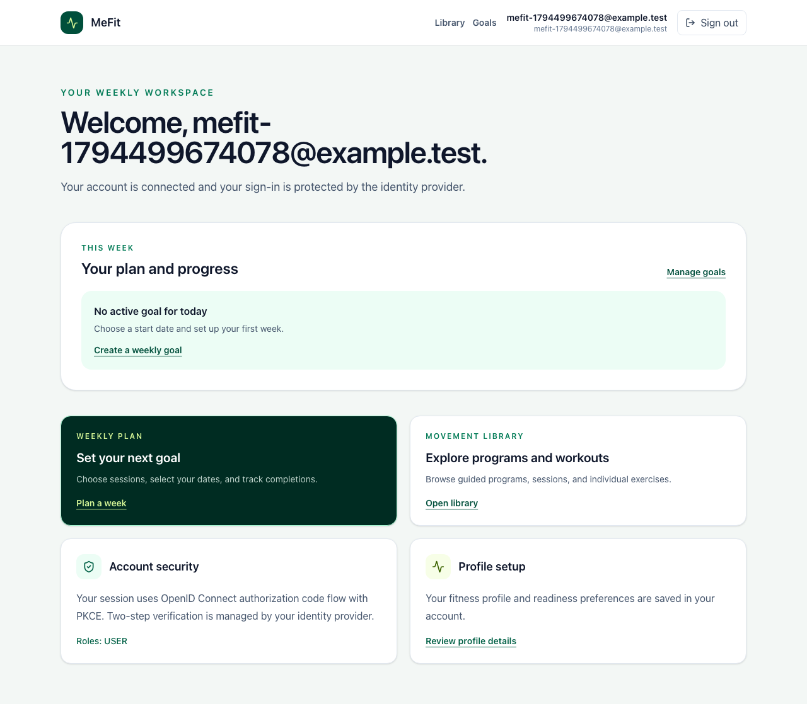
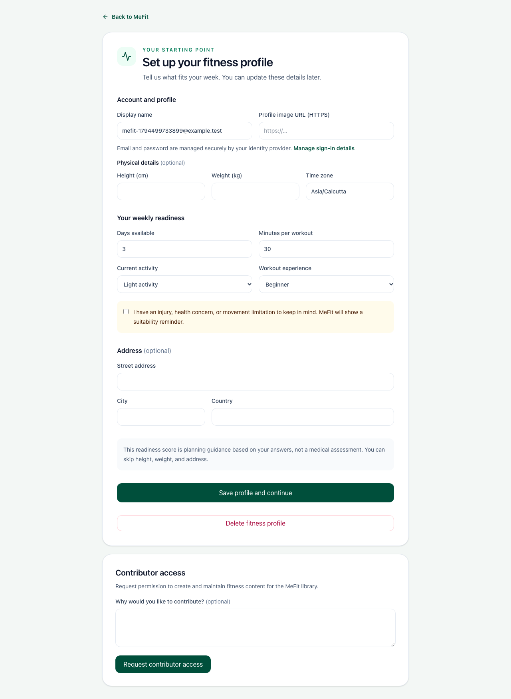
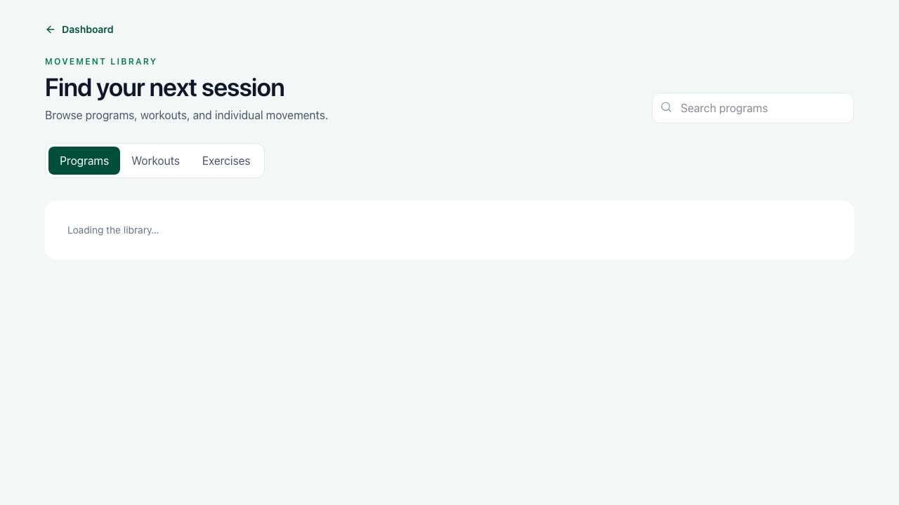
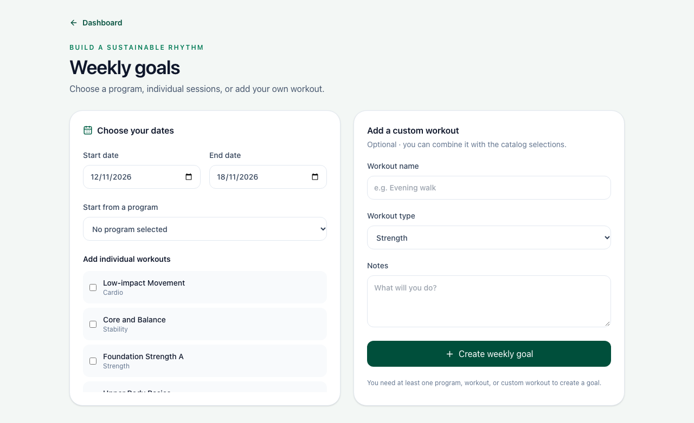
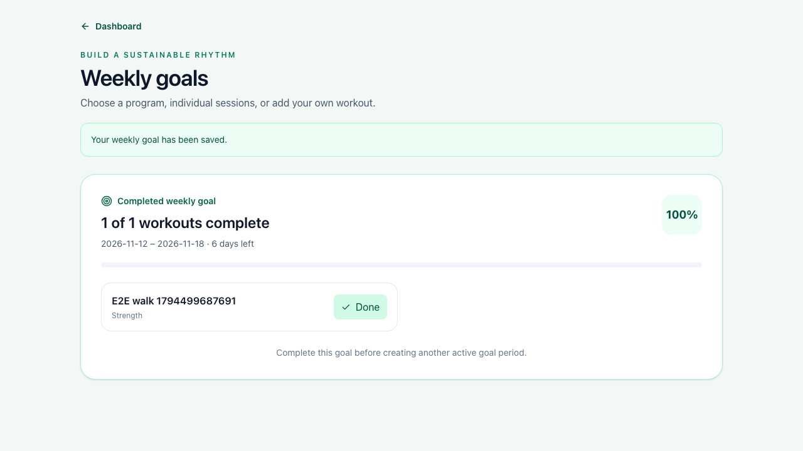

# MeFit User Guide

This guide reflects the locally verified MeFit flows. Images were captured from the running app using the Playwright browser journey.

## Create an account and complete two-step verification

1. Open `http://localhost:5173/register` and choose **Continue to registration**.
2. Complete the Keycloak registration form. MeFit does not collect or store your password.
3. At the required authenticator setup screen, scan the QR code with an authenticator app. If scanning is unavailable, use **Unable to scan?** and enter the displayed setup key.
4. Enter the six-digit authenticator code. Keycloak returns you to MeFit and the app creates your local user record.
5. Complete the fitness profile to reach the dashboard.

## Dashboard

The dashboard shows the current weekly plan, completion count, remaining days, and links to goals, the movement library, and profile details. The screenshot shows an account with no active goal.

## Set up or edit a profile

Open **Review profile details** on the dashboard, or visit `/profile/setup`. Set your display name, time zone, readiness answers, and any optional height, weight, profile image URL, and address. Select **Save profile and continue**. The app displays its versioned planning score and suitability reminder where applicable. The score is planning guidance, not a medical assessment.

## Browse the movement library

Open **Open library**. Use the tabs to switch among Programs, Workouts, and Exercises. Search by name or description, then select a result to view its details.

## Create and complete a weekly goal

Open **Goals**. Set the start/end dates (up to seven calendar days), then choose a program, individual workouts, or a custom workout. Select **Create weekly goal**. Use **Mark done** after each workout; completed items show **Done** and are disabled to prevent repeat submissions. Completing the final workout marks the goal complete.

## Contributor and administrator workflows

Contributor and Admin links appear for accounts with their corresponding roles. A regular USER account receives a permission error on contributor operations. To bootstrap the first local administrator, register its account, set `MEFIT_ADMIN_EMAIL` in the ignored `.env`, and run `bash scripts/bootstrap-local-admin.sh`. Admins can review contributor requests and assign roles. Contributors can create, edit, or archive exercises, workouts, and programs. These role-enabled flows are implemented; their screenshots and full browser verification remain outstanding.

## Sign out and account settings

Use **Sign out** in the dashboard header. Email, password, and identity-provider security settings are managed through the **Manage sign-in details** link on the profile page. Profile deletion removes fitness-profile information but retains goal history; account deletion is a separate soft-disable operation.

## Help and limitations

The application requires the local API, PostgreSQL, and Keycloak services. Follow [installation instructions](INSTALLATION.md) to start them. Public deployment, production email, media storage, and operational backups are not configured.
