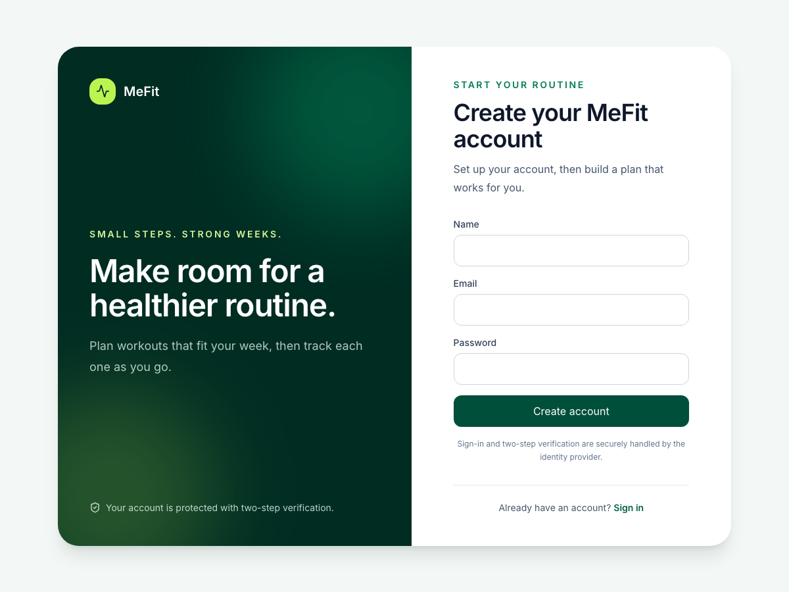
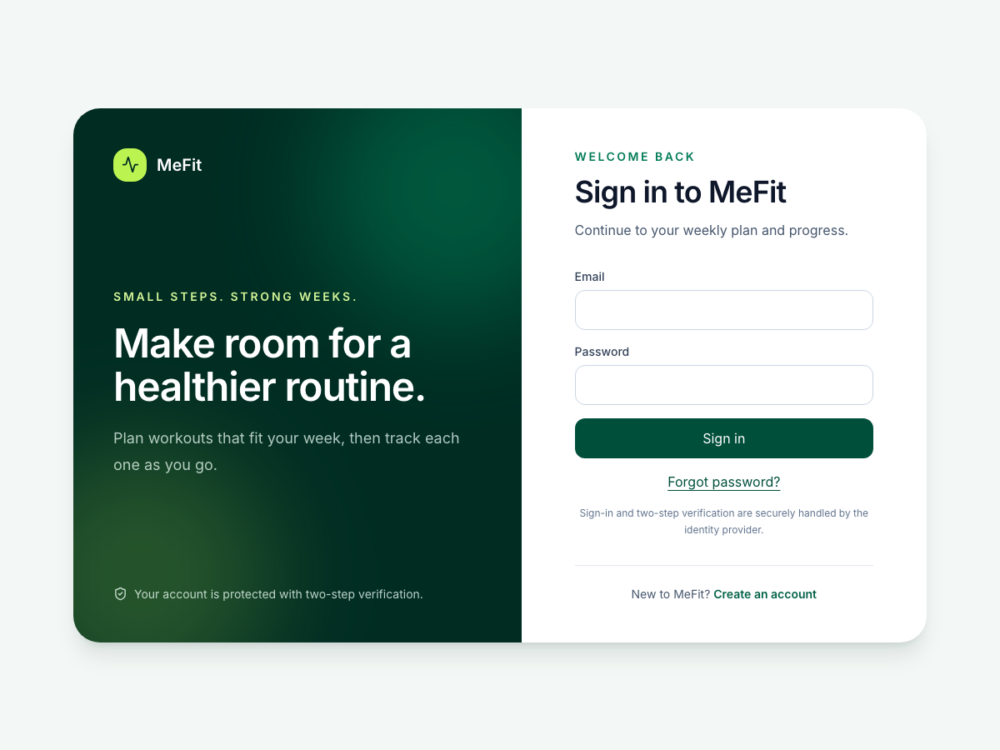

# MeFit user manual

Open [MeFit](https://mefit-fitness-planner.vercel.app/). The sign-in and registration images below show the public application. Contributor and administrator instructions describe the SRS preview candidate and require a configured staging API and the corresponding account role.

## Regular user

1. Choose **Create an account**, enter your name and email, and choose a password. Open the confirmation email if prompted.
2. At two-step verification, scan the QR code using your authenticator app. Enter the current six-digit code. Keep the setup key private.
3. Enter your fitness profile, including your time zone, experience and weekly availability. Select **Save profile and continue**, then **Go to dashboard**.
4. In **Weekly planner**, choose a week and generate a plan or add a workout. Use the workout controls to edit the date or mark it complete.
5. In **Library**, search by movement or muscle, filter the results, and open an exercise for instructions. Use the heart to save a favorite or add the exercise to a day.
6. In **Logging**, select an exercise and save the set. Use the rest timer and finish the workout when done.
7. In **Progress**, log body measurements and review available activity summaries.
8. In **Settings**, edit your profile or change units and theme. Open the account menu to sign out. Use **Forgot password?** on the sign-in screen to request a reset.

## Contributor

On the role-enabled preview, open **Contributors area** from the account menu. Select content type, open the create form, supply the required detail, and save. Use the authored items list to edit or archive existing content. For workouts, select exercises and set prescriptions. For programs, select workouts. Exercise mutation is still restricted to admins in the current API candidate.

## Administrator

On the role-enabled preview, open **Administration**. Review requests and choose **Approve** or **Reject**. Use **Accounts** to review role assignments and save authorized changes. Verify the result by signing in as the affected test user.

Hosted screenshots and smoke evidence for signed-in regular, contributor and administrator sessions are pending. The production site currently exposes the regular-user workflow.
